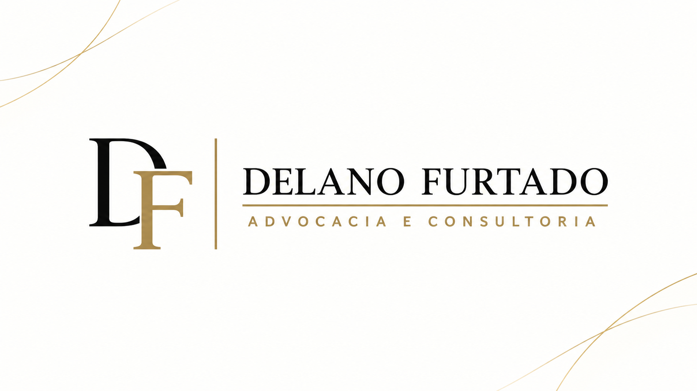

# Conteúdo e informações do site — Delano Furtado

Coleta realizada em **22 de outubro de 2026**, a partir do [site oficial](https://www.delanofurtado.adv.br/). Finalidade: preservar o conteúdo e os materiais disponíveis para utilização no projeto de um novo frontend.

Os textos transcritos abaixo mantêm a redação publicada; a formatação de listas e espaços foi normalizada para Markdown. As observações sobre a coleta são identificadas separadamente. Este documento não acrescenta promessas, serviços, qualificações ou depoimentos que não tenham sido encontrados na fonte.

## 1. Páginas e títulos encontrados

| Página | URL | Título da página retornado na consulta |
| --- | --- | --- |
| Início | https://www.delanofurtado.adv.br/ | Advogado Volta Redonda - Delano Furtado Advogado Em Volta Redonda |
| Localização | https://www.delanofurtado.adv.br/localizacao | Advogado Volta Redonda - Delano Furtado Advogado Em Volta Redonda |
| Contate-nos | https://www.delanofurtado.adv.br/contate-nos | Advogado em Volta Redonda - Delano Furtado Advogado Em Volta Redonda |

### Metadados da página inicial

Fonte: metadados publicados no HTML da [página inicial](https://www.delanofurtado.adv.br/).

| Campo | Valor |
| --- | --- |
| `description` | Advogado Volta Redonda \| Cível, Trabalhista, Previdenciário, Consumidor, Imobiliário, Família \| Advogado Barra Mansa, Pinheiral, Resende \| lista advogado em Volta Redonda |
| `og:title` | Advogado Volta Redonda |
| `og:description` | Mesmo texto de `description` acima |
| `og:type` | website |
| `twitter:title` | Advogado Volta Redonda |
| `twitter:description` | Mesmo texto de `description` acima |
| `twitter:card` | summary_large_image |

A imagem de compartilhamento (`og:image`) está documentada no inventário de mídia.

Na página [Localização](https://www.delanofurtado.adv.br/localizacao), título e descrição de SEO são os mesmos da página inicial.

Na página [Contate-nos](https://www.delanofurtado.adv.br/contate-nos), a descrição de SEO é:

> Advogado em Volta Redonda com atendimento presencial e online. Atuação em Família, Civil, Trabalhista, Contratos, Imobiliário, Bancário e Sucessões.

Foram omitidas apenas duas quebras de linha finais do valor do atributo.

## 2. Dados de identificação e contato

Informações publicadas na [página inicial](https://www.delanofurtado.adv.br/) e no rodapé das páginas internas:

| Campo | Informação publicada |
| --- | --- |
| Nome de apresentação | Delano Furtado |
| Nome completo na apresentação pessoal | Delano Santos Furtado |
| OAB | OAB/RJ: 235.314 |
| CNPJ | 50.791.942/0001-03 |
| Telefone | (24) 99922-5628 |
| E-mail | contato@delanofurtado.adv.br |
| Endereço — linha 1 | Rua 18 - B, 45 - Vila Santa Cecília |
| Endereço — linha 2 | Volta Redonda-RJ 27260-100, BR |
| Atendimento presencial | Volta Redonda, Barra Mansa, Pinheiral, Barra do Piraí, Resende e demais regiões do estado do Rio de Janeiro |
| Atendimento online | Clientes de todo o Brasil |

O destino público do [link de WhatsApp](https://api.whatsapp.com/message/HCR7BXZAX44TF1?app_absent=0&autoload=1) apresenta o nome **Delano Furtado Sociedade Individual de Advocacia**. Esse nome foi encontrado no destino do link, não no texto de apresentação da página inicial.

## 3. Navegação, botões e destinos

| Texto publicado | Destino encontrado | Onde aparece |
| --- | --- | --- |
| Início | https://www.delanofurtado.adv.br/ | Navegação superior e inferior |
| Localização | https://www.delanofurtado.adv.br/localizacao | Navegação superior e inferior |
| Contate-nos | https://www.delanofurtado.adv.br/contate-nos | Navegação superior e inferior |
| Nos Avalie | https://g.page/r/CXdwT4yvl5cREBE/review | Navegação superior e inferior |
| Fale conosco | `tel:24 99922-5628` | Cabeçalho; valor do atributo de link preservado como publicado |
| Entre em contato via WhatsApp | https://api.whatsapp.com/message/HCR7BXZAX44TF1?app_absent=0&autoload=1 | Página inicial |
| WhatsApp flutuante | https://wa.me/5524999225628?text=Ol%C3%A1%2C%20Dr.%20Delano.%20Vim%20pelo%20site%20e%20gostaria%20de%20uma%20orienta%C3%A7%C3%A3o. | Controle flutuante; identificador no HTML: `df-zap` |
| Ver Avaliações no Google | https://g.page/r/CXdwT4yvl5cREBE/review | Seção de avaliações da página inicial |
| Conte-nos mais | https://www.delanofurtado.adv.br/contate-nos | Página de localização |
| Enviar mensagem | Ação do formulário; nenhum envio foi realizado nesta coleta | Página de contato |
| Facebook | https://www.facebook.com/delanofurtado.adv/?ref=pages_you_manage | Link social encontrado no HTML |
| Instagram | https://www.instagram.com/delanofurtado.adv/ | Link social encontrado no HTML |

Mensagem pré-preenchida do WhatsApp flutuante: **Olá, Dr. Delano. Vim pelo site e gostaria de uma orientação.** A mensagem foi apenas extraída do link, sem envio.

O link de avaliação redireciona para `https://search.google.com/local/writereview?placeid=ChIJFeafLfyZngARd3BPjK-XlxE&source=g.page.m.nr._&laa=nmx-review-solicitation-recommendation-card`. Não foi possível consultar avaliações individuais por esse destino. Não se deve preencher estrelas, notas ou depoimentos no novo site a partir apenas desse link.

## 4. Página inicial — texto em ordem de apresentação

Fonte de toda esta seção: [página inicial](https://www.delanofurtado.adv.br/). A ordem foi confirmada pelo HTML e pela inspeção visual: apresentação, Sobre, Áreas de Atuação, avaliações e rodapé. Um extrator de texto consultado listava as áreas antes de Sobre; prevalece aqui a ordem confirmada no site.

### 4.1. Cabeçalho

- Início
- Localização
- Contate-nos
- Nos Avalie
- Fale conosco

### 4.2. Apresentação

**ADVOCACIA E CONSULTORIA JURÍDICA**

Com atuação presencial em Volta Redonda, Barra Mansa, Pinheiral, Barra do Piraí, Resende e demais regiões do estado do Rio de Janeiro, também realizamos atendimentos online para clientes de todo o Brasil. Prestamos assessoria jurídica judicial e extrajudicial para pessoas físicas e jurídicas, com foco em soluções estratégicas, atendimento próximo e atuação personalizada.

Nosso compromisso é conduzir cada demanda com transparência, seriedade e responsabilidade, oferecendo suporte jurídico eficiente e alinhado às particularidades de cada caso.

OAB/RJ: 235.314

CNPJ: 50.791.942/0001-03

**Botão:** Entre em contato via WhatsApp

### 4.3. Sobre

Sou Delano Santos Furtado, advogado inscrito na OAB/RJ sob o nº 235.314, com atuação presencial no estado do Rio de Janeiro e atendimento online para clientes de todo o Brasil.

Graduado em Direito pelo Centro Universitário de Volta Redonda, pós-graduado em Direito Processual Civil pela PUC/RS e em Direito Civil pela Universidade Presbiteriana Mackenzie, atuo de forma estratégica e personalizada na condução de demandas judiciais e extrajudiciais.

Meu trabalho é pautado pela transparência, proximidade e comprometimento com cada cliente, buscando soluções eficientes e alinhadas às particularidades de cada caso.

Inscrição na OAB/RJ: 235.314

CNPJ: 50.791.942/0001-03

Comprometido com uma atuação técnica, ética e personalizada, busco oferecer segurança, clareza e suporte jurídico qualificado em cada atendimento.

### 4.4. Áreas de Atuação

#### Direito de Família

- Fixação, Revisão e Exoneração de Pensão Alimentícia
- Divórcio (Litigioso ou Consensual)
- Partilha de Bens
- Guarda, Fixação de Residência e Regulamentação de Visitas dos Filhos
- Tutela e Curatela
- Reconhecimento e Dissolução de União Estável
- Reconhecimento de Paternidade (Biológica ou Sócioafetiva)
- Ação Negatória de Paternidade
- Medidas Protetivas com Base na Lei Maria da Penha

#### Direito do Consumidor

- Cobranças indevidas e negativação indevida no SPC/Serasa e Registrato
- Atrasos ou falhas na entrega de produtos e serviços
- Cláusulas abusivas em contratos de adesão
- Cancelamentos não realizados e estornos negados
- Problemas com bancos, operadoras de telefonia, planos de saúde e concessionárias de água e energia elétrica

#### Direito Imobiliário

- Usucapião
- Adjudicação Compulsória
- Ação de Despejo
- Manutenção e Reintegração de Posse
- Revisão e Arbitramento de Aluguel
- Ação Renovatória de Contrato de Locação
- Divisão e Demarcação de Terras Particulares
- Retificação de Área
- Embargos de Terceiro
- Extinção de Condomínio
- Retificação de Registros e Averbações
- Interdito Proibitório
- Nunciação de Obra Nova

#### Direito Contratual

Atuamos na elaboração, revisão e gestão de contratos civis, comerciais e empresariais, com foco na segurança jurídica e prevenção de litígios. Nossos serviços incluem:

- Contratos personalizados e adequados à legislação
- Revisão de cláusulas e redução de riscos
- Suporte em negociações e acordos comerciais
- Consultoria em contratos imobiliários e de prestação de serviços
- Monitoramento de prazos e obrigações contratuais
- Atuação em conflitos e descumprimentos contratuais
- Atendimento a diversos setores, como saúde, tecnologia, construção e varejo

#### Direito das Sucessões

Atuamos com eficiência na condução de inventários e planejamento sucessório, garantindo segurança jurídica e redução de conflitos. Nossos serviços incluem:

- Inventário judicial e extrajudicial com assessoria completa
- Planejamento sucessório e elaboração de testamentos
- Avaliação de bens e sobrepartilha patrimonial
- Mediação entre herdeiros e acordos familiares
- Solicitação de alvarás e liberação de valores
- Conversão de inventário judicial em extrajudicial
- Atendimento 100% digital, com atuação em todo o Brasil e exterior

#### Direito Civil

- Indenizações por Danos Materiais e Morais
- Responsabilidade Civil Contratual e Extracontratual
- Direito das Obrigações
- Direito de Vizinhança
- Litígios sobre Propriedades

#### Serviço Jurídico Mensal para Empresas e Pessoas Físicas

Nosso serviço jurídico mensal oferece suporte completo e personalizado para empresas e pessoas físicas. Com ele, você garante assessoria jurídica contínua para enfrentar questões legais do dia a dia, prevenindo litígios e agilizando processos. O serviço inclui consultoria, elaboração de contratos, análise de riscos, acompanhamento de demandas judiciais e extrajudiciais, além de orientações estratégicas para a proteção de seus direitos.

Ideal para quem busca segurança jurídica e tranquilidade em suas decisões.

### 4.5. Confira Nossas Estrelas!

Navegue pelas opiniões de quem já experimentou nossos serviços e descubra o impacto da nossa qualidade.

**Botão:** Ver Avaliações no Google

**Observação da coleta:** a extração da página encontrou o convite e o link de avaliação. Não foram encontrados textos de avaliações individuais, nomes de avaliadores ou uma nota numérica nessa seção. Não há base nesta coleta para criar depoimentos ou atribuir uma pontuação.

### 4.6. Rodapé

Navegação repetida:

- Início
- Localização
- Contate-nos
- Nos Avalie

**Endereço**

Rua 18 - B, 45 - Vila Santa Cecília

Volta Redonda-RJ 27260-100, BR

(24) 99922-5628

contato@delanofurtado.adv.br

**Atendimento**

Atuação presencial em Volta Redonda, Barra Mansa, Pinheiral, Barra do Piraí, Resende e demais regiões do estado do Rio de Janeiro. Também realizamos atendimentos online para clientes de todo o Brasil.

**Siga-nos**

Ícones com links para Facebook e Instagram, nos destinos registrados na seção 3.

## 5. Página Localização

Fonte: [Localização](https://www.delanofurtado.adv.br/localizacao).

O cabeçalho e o rodapé repetem a navegação e os dados de contato documentados acima.

### Escritório em Volta Redonda

Prestação de serviços jurídicos em Volta Redonda, Barra Mansa, Pinheiral e Resende no estado Rio de Janeiro, de advocacia judicial e extrajudicial, bem como consultoria e assessoria jurídica nas áreas do direito do consumidor, trabalhista, imobiliário, previdenciário, cível e de família.

**Botão:** Conte-nos mais

Destino: https://www.delanofurtado.adv.br/contate-nos

### Mapa incorporado encontrado

O HTML da página inclui um iframe de mapa cujo endereço é:

```text
https://components.mywebsitebuilder.com/extern/maps-app/embed-place-express.html?q=rua+18+-+b,+45+-+vila+santa+cec%C3%ADlia,27260-100,Volta+Redonda-RJ,BR&zoom=14&mapType=roadmap&center=none
```

Parâmetros publicados: zoom `14`, tipo `roadmap`, consulta com o endereço do escritório. O carregamento do mapa dentro do iframe não foi confirmado; a presença do endereço de incorporação foi confirmada no HTML.

## 6. Página Contate-nos

Fonte: [Contate-nos](https://www.delanofurtado.adv.br/contate-nos).

O cabeçalho e o rodapé repetem a navegação e os dados de contato documentados acima.

### Vamos conversar sobre o seu caso?

Preencha o formulário para que alguém da minha equipe possa entrar em contato com você.

Campos e rótulos encontrados:

1. Nome
2. Sobrenome
3. Seu e-mail
4. Assunto do e-mail
5. Sua mensagem

Os cinco campos têm o atributo `required` no HTML. A caixa de consentimento não tem esse atributo.

Texto associado à caixa de consentimento, publicado em inglês:

> By checking this box and submitting your information, you are granting us permission to email you. You may unsubscribe at any time.

**Botão:** Enviar mensagem

### Texto de confirmação encontrado no conteúdo da página

**Mensagem enviada!**

Sua mensagem foi enviada com sucesso. Esperamos responder em até 24 horas. Você também pode nos contatar através de redes sociais. Os links estão logo abaixo.

**Observação da coleta:** essa mensagem foi encontrada no conteúdo extraído da página. O formulário não foi preenchido nem enviado; o texto não representa a confirmação de um envio realizado nesta pesquisa. Os destinos de Facebook e Instagram identificados no HTML estão registrados na seção de links.

## 7. Informações consolidadas para reaproveitamento

Este resumo agrupa fatos publicados; não substitui as transcrições acima.

- Formação: graduação em Direito pelo Centro Universitário de Volta Redonda; pós-graduação em Direito Processual Civil pela PUC/RS; pós-graduação em Direito Civil pela Universidade Presbiteriana Mackenzie. Fonte: [Sobre, na página inicial](https://www.delanofurtado.adv.br/).
- Público indicado: pessoas físicas e jurídicas. Fonte: [apresentação e serviço mensal, na página inicial](https://www.delanofurtado.adv.br/).
- Formas de atuação indicadas: demandas judiciais e extrajudiciais, assessoria e consultoria. Fonte: [página inicial](https://www.delanofurtado.adv.br/).
- Sete blocos de serviços na página inicial: Família, Consumidor, Imobiliário, Contratual, Sucessões, Civil e Serviço Jurídico Mensal para Empresas e Pessoas Físicas. Fonte: [Áreas de Atuação](https://www.delanofurtado.adv.br/).
- Atendimento online para o Brasil no texto geral; o bloco de Sucessões também menciona exterior. Fonte: [página inicial](https://www.delanofurtado.adv.br/).

## 8. Divergências e limites encontrados

- A [página Localização](https://www.delanofurtado.adv.br/localizacao) menciona Direito Trabalhista e Previdenciário, enquanto a [página inicial](https://www.delanofurtado.adv.br/) não apresenta blocos específicos dessas áreas. As duas versões foram preservadas; é preciso decidir editorialmente quais serviços entram no novo site.
- A descrição de SEO da página inicial também menciona Trabalhista e Previdenciário. Essa informação não foi convertida em blocos de serviço adicionais.
- A descrição de SEO de Contate-nos menciona Direito Bancário, que não aparece como bloco específico na página inicial. A descrição e os blocos de conteúdo foram preservados sem tentar unificá-los.
- A referência a atendimento no exterior aparece especificamente no bloco de Sucessões. Não foi generalizada para todos os serviços.
- Não foi encontrado horário de funcionamento no texto das três páginas consultadas.
- Não foram encontrados textos individuais de depoimentos ou nota de avaliação no conteúdo textual extraído. O destino Google encontrado é um link de avaliação.
- A captura textual não confirma a existência ou a ausência de elementos puramente gráficos, mapas incorporados, ícones ou conteúdo carregado por scripts. O inventário de mídia complementa essa parte.
- Nenhuma mensagem foi enviada e nenhum formulário foi submetido durante a coleta.

## 9. Fontes consultadas

- [Página inicial](https://www.delanofurtado.adv.br/)
- [Localização](https://www.delanofurtado.adv.br/localizacao)
- [Contate-nos](https://www.delanofurtado.adv.br/contate-nos)
- [Destino público do WhatsApp](https://api.whatsapp.com/message/HCR7BXZAX44TF1?app_absent=0&autoload=1)
- [Link de avaliação Google publicado no site](https://g.page/r/CXdwT4yvl5cREBE/review) — destino de avaliação identificado; avaliações individuais não acessíveis nesta consulta.

## 10. Inventário de arquivos de mídia

Foram baixados **sete arquivos originais distintos**, identificados nas imagens, nos fundos CSS e nos metadados das três páginas. Os arquivos estão em [assets/delano-furtado/](assets/delano-furtado/), sem recorte, compressão adicional ou edição. As dimensões abaixo foram verificadas nos arquivos locais. O [manifesto JSON](assets/delano-furtado/manifesto.json) registra origem, tamanho e SHA-256 de cada arquivo.

| Material | Arquivo local | Dimensões originais | Local de uso |
| --- | --- | --- | --- |
| Logo horizontal completo | [logo-delano-furtado-original.png](assets/delano-furtado/logo-delano-furtado-original.png) | 2172 × 724 px | Cabeçalho e rodapé das três páginas |
| Retrato profissional do Delano | [retrato-delano-furtado-original.jpg](assets/delano-furtado/retrato-delano-furtado-original.jpg) | 2784 × 4179 px | Seção Sobre da página inicial |
| Monograma DF / favicon | [favicon-monograma-df.png](assets/delano-furtado/favicon-monograma-df.png) | 1254 × 1254 px | Ícone do site (`shortcut icon`) |
| Arte para compartilhamento | [imagem-compartilhamento-delano-furtado.png](assets/delano-furtado/imagem-compartilhamento-delano-furtado.png) | 1672 × 941 px | Metadados `og:image` e `twitter:image` |
| Ícone do Google Maps | [icone-google-maps.png](assets/delano-furtado/icone-google-maps.png) | 512 × 512 px | Seção de convite a avaliações da página inicial |
| Fotografia da estátua da Justiça | [estatua-justica-localizacao.jpg](assets/delano-furtado/estatua-justica-localizacao.jpg) | 512 × 342 px | Página Localização |
| Textura cinza escura | [textura-fundo-cinza.png](assets/delano-furtado/textura-fundo-cinza.png) | 1600 × 900 px | Recurso referenciado como fundo CSS da página inicial |

### Logo e identificação gráfica

O logo apresenta o monograma **DF**, o nome **DELANO FURTADO** e o complemento **ADVOCACIA E CONSULTORIA**. Sua linguagem visual combina preto e dourado, letras serifadas no nome e no monograma, separador vertical e linha horizontal fina.

O PNG do logo horizontal tem transparência. O monograma usado como favicon também tem transparência. Essa característica foi confirmada nos pixels dos arquivos locais. Não foi localizado um arquivo vetorial SVG do logo nos recursos publicados consultados.


### Fotografia profissional

A foto original mostra Delano sentado à mesa, de terno cinza, camisa branca e gravata escura, com uma planta ao fundo. A página aplica um recorte circular, mas o arquivo preservado é vertical e mostra uma área maior do corpo e do ambiente. O novo frontend pode trabalhar com esse original sem depender do recorte do site atual.


### Imagem de compartilhamento

Arte horizontal de fundo claro, com o logo preto/dourado e linhas douradas decorativas nos cantos. É um arquivo distinto do logo transparente.



O HTML aponta para uma versão CDN redimensionada e declara `og:image:width=1200` e `og:image:height=630`. O arquivo original recuperado mede **1672 × 941 px**; as dimensões declaradas no metadado não são as dimensões desse original.

URL publicada no metadado:

```text
https://images.builderservices.io/s/cdn/v1.0/i/m?url=https%3A%2F%2Fstorage.googleapis.com%2Fproduction-hostgator-brasil-v1-0-0%2F230%2F916230%2FpM9yihY2%2F9a1443b6755449c1a7fdb7f08b0df240&methods=resize%2C1200%2C5000
```

### Origem dos arquivos originais

As páginas usam URLs da CDN `images.builderservices.io` que incluem, no parâmetro `url`, o endereço do arquivo original hospedado em `storage.googleapis.com`. Foram acessados e baixados esses endereços originais publicados. No caso do favicon, o próprio HTML já publica o endereço original diretamente.

| Material | URL original |
| --- | --- |
| Logo horizontal | [Arquivo de origem](https://storage.googleapis.com/production-hostgator-brasil-v1-0-0/230/916230/pM9yihY2/d44bdee7ee5b483abb032b82b4de69ca) |
| Retrato profissional | [Arquivo de origem](https://storage.googleapis.com/production-hostgator-brasil-v1-0-0/230/916230/pM9yihY2/a17f3fd71bb24ffd914d5418fff16c53) |
| Monograma / favicon | [Arquivo de origem](https://storage.googleapis.com/production-hostgator-brasil-v1-0-0/230/916230/pM9yihY2/6b702da6d8de4e9284dfde4cb6c24843) |
| Compartilhamento | [Arquivo de origem](https://storage.googleapis.com/production-hostgator-brasil-v1-0-0/230/916230/pM9yihY2/9a1443b6755449c1a7fdb7f08b0df240) |
| Google Maps | [Arquivo de origem](https://storage.googleapis.com/production-hostgator-brasil-v1-0-0/230/916230/pM9yihY2/1afd0cee0efc4a93bbb209aa325d1fcd) |
| Estátua da Justiça | [Arquivo de origem](https://storage.googleapis.com/production-hostgator-brasil-v1-0-0/230/916230/pM9yihY2/011e47b5a4f44d6a9c686d50ecdf8d66) |
| Textura | [Arquivo de origem](https://storage.googleapis.com/production-hostgator-brasil-v1-0-0/230/916230/pM9yihY2/fa0c3ae40f894f8489a06920e73054e7) |

### Observações sobre os materiais

- Cabeçalho e rodapé usam versões redimensionadas do mesmo logo, e não dois logos diferentes. O original maior foi preservado uma única vez.
- O ícone do Google Maps é uma ilustração do serviço, não uma captura do mapa do escritório nem uma prova de nota de avaliação.
- A foto da estátua da Justiça é uma imagem temática, não uma fotografia do endereço físico.
- O texto alternativo do retrato no site diz `body of water inside cave`, embora a imagem mostre o profissional; o texto alternativo da foto da Justiça diz `man checking his DSLR camera`. Esses rótulos publicados não descrevem as imagens reais e não devem orientar a identificação dos arquivos.
- A textura foi encontrada como recurso de fundo CSS. Isso não significa que esteja visível em todos os tamanhos de tela ou estados de carregamento.
- Ícones genéricos de interface e recursos internos da plataforma de construção do site não foram tratados como materiais próprios da marca.
- Não foram localizados vídeos, PDFs, galeria adicional ou outros retratos distintos nos recursos das três páginas inspecionadas.
