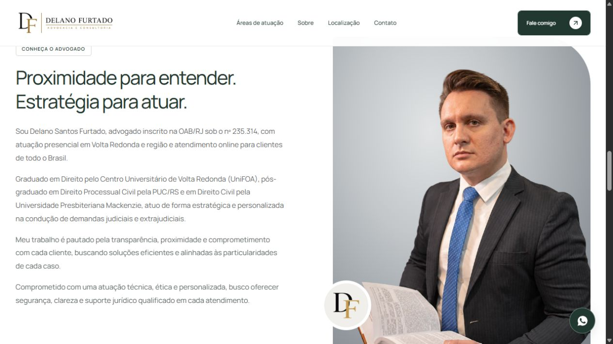
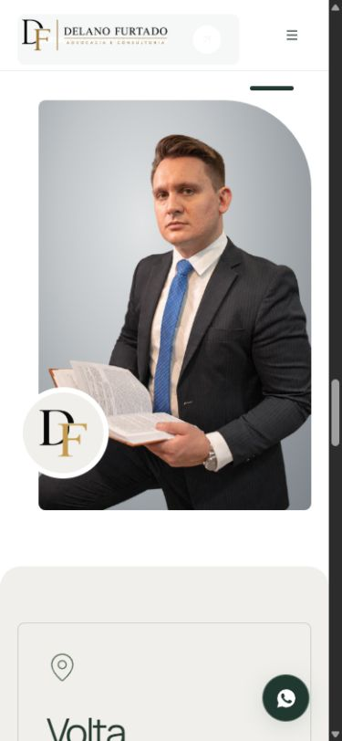
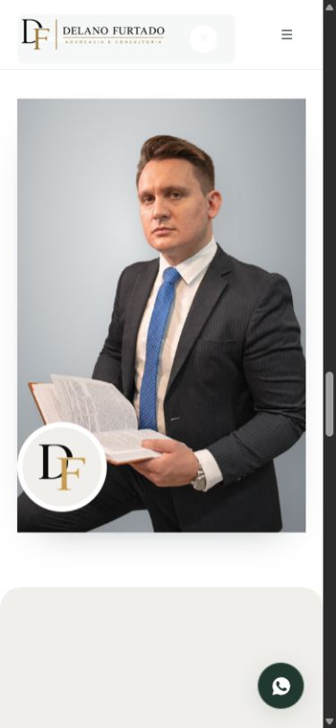
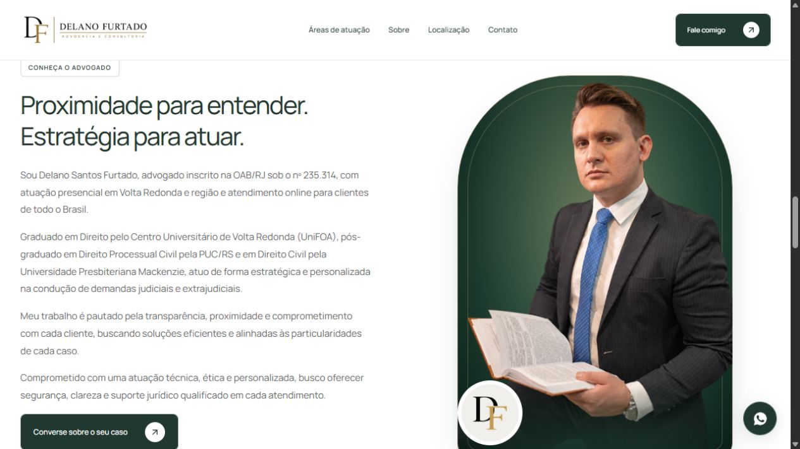
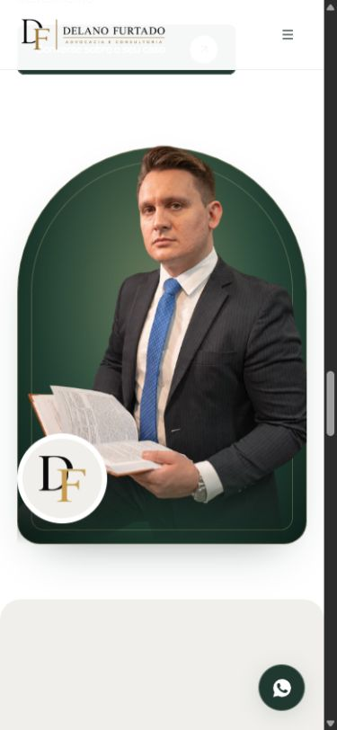

# Teste do retrato sem fundo — 27/10/2026

## Objetivo e resultado

Testar a foto fornecida pelo usuário na seção **Conheça o advogado**, sem o cenário original, com integração visual semelhante à Hero. Após a primeira prévia sobre branco, o usuário pediu um fundo com mais contraste.

Os recortes e fundos alternativos foram etapas de teste. A orientação final do usuário foi **voltar à fotografia original da captura, incluindo seu cenário**. A versão ativa usa `media.portrait` com `delano-sobre-480/800/1200.webp`, preparados a partir do JPEG original fornecido. O fundo cinza CSS foi removido. A moldura, o enquadramento superior, o selo sobreposto e o traço verde estão mantidos. Os arquivos experimentais permanecem preservados, com o contrato `media.portraitCutout`, sem uso na seção. Texto, CTA, grade e retrato da Hero permanecem independentes desta alteração.

## Origem e arquivos

- Original fornecido: [retrato-delano-furtado-sobre-2026-10-27.jpg](../assets/delano-furtado/retrato-delano-furtado-sobre-2026-10-27.jpg), preservado integralmente, 3016 × 4528.
- Recorte editado com imagegen: [retrato-delano-furtado-sobre-sem-fundo-v1.png](../assets/delano-furtado/retrato-delano-furtado-sobre-sem-fundo-v1.png), 1023 × 1537, RGBA, 1.586.559 bytes.
- SHA-256 do recorte: `f5eb6c25c5c3f865289a92dd97166ada2970ad2a1f6fd89cfc0e164f607712c3`.
- Origem e método registrados em `edited_assets` no [manifesto](../assets/delano-furtado/manifesto.json), separados dos originais coletados e fornecidos. O PNG é uma edição por IA; não é o original fotográfico.
- Derivados WebP com alpha: `delano-sobre-recorte-480.webp` (480 × 721, 55.592 bytes), `delano-sobre-recorte-800.webp` (800 × 1202, 125.868 bytes), `delano-sobre-recorte-1023.webp` (1023 × 1537, 181.674 bytes). Sem EXIF e sem ampliação da resolução.
- Pipeline: `scripts/prepare-assets.mjs` verifica também os hashes de `edited_assets` antes de preparar os derivados.
- Aplicação: `src/content/media.ts` e `src/pages/Home/sections/AboutSection.tsx`. `srcset`, `sizes`, dimensões explícitas e lazy loading preservados.

## Modo e prompt de edição

Ferramenta: `image_gen.imagegen`, modo **edit/background-extraction**, original em `referenced_image_paths`, `transparent_background: true`. O resultado selecionado foi copiado para o projeto, preservando o arquivo gerado e o original fornecido. Sharp é usado somente na preparação dos tamanhos e formatos do frontend.

```text
Use case: background-extraction. Edit target: the supplied original photograph of Delano Furtado seated holding an open law book. Remove only the room/background and all visible furniture/chair, including the wall and the chair behind him. Return the SAME photographed man, his entire currently visible body, suit, shirt, blue tie, watch, both hands, and the open book, isolated on a genuinely transparent alpha background. Preserve his exact identity, facial features, expression, hair, skin texture, pose, proportions, original warm photographic lighting, clothing details and book. This is a precise background removal, not a new portrait: do not beautify, retouch, repaint, re-pose, change facial structure, add limbs or invent missing body parts. Preserve natural fine hair edges and clean suit edges without white or dark halos. Keep original portrait aspect ratio and the full existing subject framing, no added text, logo, shadows or colored background. The cutout will be used on a lawyer website like its hero portrait, with a subtle CSS fade at the bottom applied later in the website. Transparent pixels must be actual transparency, not a drawn checkerboard.
```

## Verificação

- `npm run assets:prepare`: concluído; 20 arquivos preparados, 7 originais coletados + 1 fornecido + 1 editado + 2 ativos da Hero verificados por hash.
- Alpha do PNG e dos três WebPs: canal presente, valores de 0 a 255, transparência real; derivados sem EXIF.
- `npm run lint`, `npm run build` e `npm run verify:build`: aprovados após o ajuste do fundo verde. Três rotas públicas e 404 pré-renderizados, mídia local validada.
- Inspeção no navegador em 1280 × 720 e 390 × 844: retrato carregado, enquadramento e transição visíveis, sem overflow horizontal. Retrato móvel com 335 × 503px no espaço disponível. Console sem erros na sessão inspecionada. Override de viewport restaurado ao final.
- Sem mudança de comportamento interativo; não foram acrescentados testes que apenas repetem CSS. Sem publicação remota nesta tarefa.

## Capturas

### Versão atual — fotografia original

Retorno ao JPEG fornecido, usando os derivados WebP existentes e sem nova edição de imagem. `npm run lint`, `npm run build` e `npm run verify:build` aprovados após a restauração.

Conferência no navegador em 1280 × 720: `delano-sobre-800.webp` carregado, cenário original visível, `background-image: none`, sem overflow horizontal e sem erros no console.


### Teste anterior — moldura original com fundo cinza

Conferida em 1280 × 720 e 390 × 844: bordas computadas em `8px 100px 8px 8px`, retrato carregado, sem overflow horizontal e console sem erros. Retrato desktop com aproximadamente 538 × 650px; no celular, largura de 311px no espaço disponível. `npm run lint`, `npm run build` e `npm run verify:build` aprovados após restaurar a moldura. O arquivo do recorte não foi regenerado.





### Teste anterior — estúdio cinza com cantos retos

Conferida em 1280 × 720 e 390 × 844: cantos computados em `0px`, retrato carregado, sem overflow horizontal e console sem erros. `npm run lint`, `npm run build` e `npm run verify:build` aprovados após esta alteração. A edição foi exclusivamente no cenário CSS; o arquivo do recorte não foi regenerado.




### Teste anterior — painel verde





## Reversão

O retorno ao original está concluído: `media.portrait` aponta para a fotografia com cenário original e a regra `.photo` não aplica fundo cinza. O recorte sem fundo está preservado em `media.portraitCutout` para referência histórica, sem uso na seção. O JPEG original fornecido não foi sobrescrito em nenhuma etapa.
