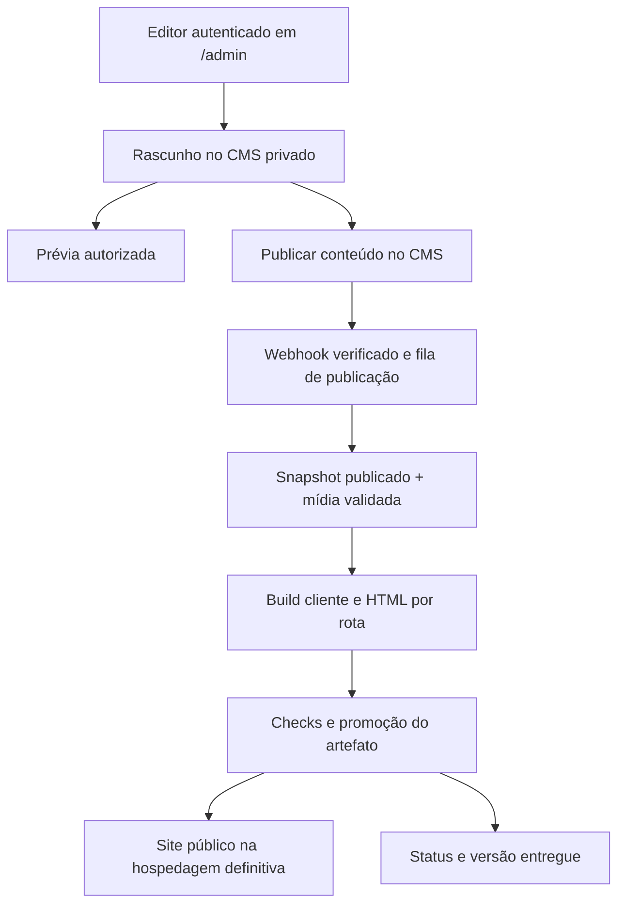

# Área Administrativa, Gestão de Conteúdo e Ordem das Seções — Implementation Plan

> **For agentic workers:** executar tarefa por tarefa com `superpowers:executing-plans`, ou com `superpowers:subagent-driven-development` se esse método estiver autorizado. Ler os contratos antes de implementar. Os checkboxes representam execução comprovada, não elaboração deste documento.

**Goal:** disponibilizar uma área administrativa em `/admin` para pessoas autorizadas editarem textos, fotos e imagens das três páginas e reordenarem as seções existentes da Home, com rascunho, prévia, publicação verificável e recuperação da versão anterior.

**Architecture:** proposta de Sanity Studio integrado em uma entrada Vite separada, com autenticação e permissões no CMS, dataset privado e um documento de conteúdo do site. O frontend público continua estático: uma publicação de conteúdo dispara preparação de snapshot, otimização de mídia, build, validação e promoção do artefato. Hospedagem final e integração de publicação precisam ser confirmadas antes de implementar a conexão externa.

**Tech Stack:** preservar React 19, TypeScript 6 estrito, Vite 8, Router DOM 6, styled-components 6, shadcn/Base UI/Tailwind 4, GSAP e a suíte existente. Propostos: `sanity` no painel, `@sanity/client` no Studio e nos scripts de conteúdo, Zod para validação compartilhada e `tsx` para scripts TypeScript. Sharp existente prepara os derivados. Um adaptador de publicação executará no servidor/CI, separado dos bundles. Versões novas serão fixadas no lockfile após checar compatibilidade; nenhuma dependência foi instalada neste planejamento.

**Spec:** pedido do usuário e especificação funcional nas seções 2–7 deste arquivo, baseados em [docs/README](../docs/README.md), [Stack](../docs/stack-e-decisoes-tecnicas.md), [Arquitetura](../docs/arquitetura.md), [Conteúdo](../docs/rotas-e-conteudo.md), [Design](../docs/design-system.md), [Código](../docs/padroes-de-codigo.md), [Segurança](../docs/seguranca-e-privacidade.md), [Integrações](../docs/integracoes-e-formularios.md), [Qualidade](../docs/qualidade-e-validacao.md) e [Deploy](../docs/deploy-e-operacao.md).

**Data:** 23/10/2026. **Estado:** planejado; implementação não iniciada. **Baseline:** `c6c8566`, `main`, com alterações documentais dos planos anteriores preservadas. **Escopo confirmado pelo usuário:** reordenar blocos existentes, mantendo o design; não criar um editor livre de layouts.

## Global Constraints

- Preservar `/`, `/localizacao`, `/contate-nos`, seus HTMLs iniciais, aliases válidos e a resposta 404. `/admin` e suas subrotas não entram no manifest público nem no sitemap.
- Preservar a Hero escura do plan-002, marca, responsividade e movimento existente. Edição de conteúdo não concede execução de HTML, JavaScript, CSS, iframes ou componentes arbitrários.
- As oito seções atuais continuam disponíveis; os sete serviços mantêm seus IDs e seu conteúdo inicial. A mudança de ordem conserva os IDs das âncoras.
- Login e autorização são controles no serviço de dados; esconder um link, usar um caminho difícil, `noindex`, CORS ou um guard React não substitui esses controles.
- Netlify é homologação temporária. O plano não escolhe a hospedagem final, não migra DNS e não pressupõe Netlify Identity, Functions ou Git Gateway.
- Conforme D14 e plan-003, implementar GA4 somente depois da publicação definitiva validada. Este plano não instala medição; painel e prévia ficam fora dos eventos de visitantes, inclusive quando GA4 existir.
- Conteúdo em pt-BR. Fontes factuais: documento 02, dados atuais e procedência das avaliações. Não inventar qualificações, depoimentos, estatísticas ou promessas por preencher campos.
- Nenhuma conta, contratação, convite, segredo, upload externo, banco ou webhook será criado por esta entrega documental. Código e configurações ainda são os do MVP.

## Review Focus

| Condição crítica | Resultado esperado / tarefa que verifica |
| --- | --- |
| Visitante anônimo ou conta autenticada sem vínculo com o projeto acessa API/painel | Nenhum documento privado ou operação de escrita acessível; AUTH-01 |
| Rascunho existe e um build público é iniciado | Build usa exclusivamente conteúdo publicado; preview não exporta rascunhos para `dist/`, cache ou snapshot público; PREVIEW-01/BUILD-01 |
| Editor muda a ordem, há âncora ativa e a prévia já possui ScrollTriggers | IDs/keys estáveis, foco preservado e cleanup dos efeitos anteriores; CONTENT-01/EDITOR-01/PREVIEW-01 |
| Imagem tem extensão falsa, dimensão excessiva, SVG ativo ou referência para host externo | Não chega ao artefato; upload orientado e validação efetiva no processamento; MEDIA-01 |
| Webhook repetido/atrasado, build quebrado ou duas publicações seguidas | Não rebaixar a versão ativa nem afirmar sucesso antes da promoção; PUBLISH-01/RELEASE-01 |

## 1. Agentes responsáveis

Os perfis são responsabilidades em Markdown, conforme [agents/README](../agents/README.md). Não representam processos iniciados nem autorização de delegação.

| Perfil | Entrega nesta tarefa |
| --- | --- |
| **[Software Architect](../agents/software-architect.md) — principal** | Fronteiras CMS/site, contrato de conteúdo, snapshot e decisões de infraestrutura |
| [Product Manager](../agents/product-manager.md) | Limites do editor, usuários iniciais, critérios de aceite e prioridade dos campos |
| [Backend & Integrations Engineer](../agents/backend-integrations-engineer.md) | CMS, migração, webhook, fila e integração de publicação |
| [Security Engineer](../agents/security-engineer.md) | Autenticação real, permissões, credenciais, imagens, prévia e validação de webhook |
| [UX/UI Designer](../agents/ux-ui-designer.md) + [Frontend Engineer](../agents/frontend-engineer.md) | Organização do painel, campos, reordenação acessível e estados de publicação |
| [SEO & Content Specialist](../agents/seo-content-specialist.md) | Conteúdo factual, campos SEO, HTML inicial e exclusão das rotas administrativas |
| [Motion Engineer](../agents/motion-engineer.md) | Preservação de GSAP e cleanup quando a prévia muda de ordem |
| [DevOps & Release Engineer](../agents/devops-release-engineer.md) | Provedor definitivo, entradas de build, segredo de leitura, deploy atômico e rollback |
| [QA Engineer](../agents/qa-engineer.md) + [Accessibility & Performance Engineer](../agents/accessibility-performance-engineer.md) | Permissões, publicação, teclado, mobile, hidratação e isolamento do bundle público |
| [Code Reviewer](../agents/code-reviewer.md) + [Technical Writer](../agents/technical-writer.md) | Revisão da entrega, manual do editor e evidências de operação |

Na execução da interface, consultar as skills disponíveis `ui-ux-pro-max` e `shadcn`; para a adaptação do movimento, `gsap-react` e `gsap-scrolltrigger`. Brainstorming e writing-plans orientaram esta proposta; não houve execução de produto.

## 2. Estado real e mudanças necessárias

| Item inspecionado | Estado atual | Consequência |
| --- | --- | --- |
| `src/pages/Home/index.tsx` | Oito componentes em sequência fixa no JSX | Reordenar apenas um array de dados hoje não altera a página |
| `src/content/homeContent.ts` | Existe `sectionOrder`, mas a Home não o consome | Substituir essa indicação por um contrato realmente usado pelo renderizador |
| `siteData.ts`, `services.ts`, `media.ts`, `reviews.ts`, `seo.ts` | Dados e imagens centralizados parcialmente | Migrar uma vez e definir o CMS como fonte editorial após o corte |
| Seções, Header/Footer, Location e Contact | Há títulos, legendas, botões e textos diretamente no JSX | Inventariar e extrair também esses campos; não limitar o painel aos arquivos `content/` |
| `entry-server.tsx` + `scripts/prerender.mjs` | HTML/CSS/metadados das três páginas no build | Uma edição precisa reconstruir o artefato, além de atualizar o cadastro |
| `SiteLayout` | Header, Footer, WhatsApp, SEO e GSAP envolvem todas as rotas atuais | Painel usa entrada/layout próprios, sem receber essa composição |
| `usePageMotion` | Reconstrói efeitos conforme `routeKey` | Prévia precisa considerar também a revisão/ordem do conteúdo |
| Autenticação, API e CMS | Ausentes de código e dependências | Uma rota React e senha em variável pública seriam insuficientes |
| Publicação | Netlify temporário; provedor/domínio finais pendentes | Conexão de publicação definitiva depende de ENV-ADMIN-00 |

O requisito amplia deliberadamente o escopo inicial sem backend. As guidelines continuam descrevendo o MVP instalado até as respectivas tarefas serem implementadas e verificadas.

## 3. Alternativas e proposta técnica

| Caminho | Benefício neste projeto | Custo e limite |
| --- | --- | --- |
| **CMS gerenciado com Studio em `/admin` — proposta deste plano** | Edição estruturada, mídia, rascunhos, login e permissões usando recursos do CMS; site público permanece estático | Dependência do fornecedor e plano compatível com dataset privado/Editor; publicação estática precisa de pipeline |
| CMS ligado ao Git, como Decap | Conteúdo versionado junto ao repositório | Exige autenticação Git/OAuth e permissões de repositório; uploads e experiência editorial ficam ligados aos commits/builds |
| Painel próprio + Auth/banco/storage, como Supabase | Controle completo da experiência e dos dados | Exige desenvolver editor, autorização/RLS, mídia, revisão, publicação e operação; maior superfície a manter |

**Recomendação do agente, não contratação aprovada:** Sanity Studio integrado, proporcional ao editor de blocos fixos solicitado. A documentação confirma integração em uma aplicação React e acesso autenticado ao conteúdo privado. As funções Editor e dataset privado dependem do plano disponível; não apresentar a solução completa como gratuita. Confirmar custos, titularidade e permissões em ENV-ADMIN-00. [Embedding](https://www.sanity.io/docs/studio/embedding-sanity-studio), [Datasets](https://www.sanity.io/docs/content-lake/datasets), [Roles](https://www.sanity.io/docs/user-guides/roles).

Se custo ou fornecedor inviabilizar essa escolha, rever a seção 3 e os contratos de integração antes de implementar. Não trocar para autenticação caseira ou entregar privilégios de Administrator ao editor para contornar um limite comercial. O contrato do site e as regras de ordenação permanecem reaproveitáveis.

## 4. Escopo funcional do primeiro painel

### 4.1. Conteúdo administrável

| Área | Campos editáveis | Limites preservados |
| --- | --- | --- |
| Identidade e canais | Nome, identificação profissional, contatos, endereço, regiões e redes | Uma fonte para UI, links e JSON-LD; alterações factuais precisam de confirmação do responsável |
| Hero | Rótulo, duas partes do título, descrição, legenda, CTA, retrato e fundo | Um H1; layout escuro, recorte e responsividade existentes; foto recortada exige arquivo adequado |
| Formação | Títulos e instituições das credenciais atuais | Não deduzir formação ou títulos novos |
| Áreas de atuação | Títulos, sínteses e itens dos sete serviços | IDs fixos; sem criar páginas ou categorias novas nesta etapa |
| Sobre | Título, rótulo, parágrafos, CTA e retrato | Layout da seção preservado; IDs estáveis para os parágrafos |
| Atendimento | Textos, região principal, lista de cidades e link de localização | Mesma fonte do cadastro do endereço; não duplicar cidade em strings independentes |
| Diferenciais | Título da seção, títulos e descrições dos itens | Conteúdo factual, sem métricas inventadas |
| Avaliações | Título da seção, seleção e transcrições vinculadas à fonte | Guardar origem/data de conferência; não converter uma edição em avaliação fictícia ou estrela de schema |
| Contato e localização | Textos das páginas/seção, rótulos de canais e instruções | Somente canais existentes; não acrescentar formulário de envio por consequência do CMS |
| Marca e mídia | Logo, monograma, fotos, fundo e imagens sociais, alt e enquadramento | Manter integridade da marca e dimensões adequadas; Google não vira uma marca editável do escritório |
| SEO | Título, descrição e imagem social por rota pública | Domínio, canonical, robots e código JSON-LD são calculados/configurados fora do editor |
| Ordem da Home | Mover as seções existentes | Mesmo desenho e mesma ordem em desktop/mobile; sem coordenadas ou CSS livres |

Não entram no primeiro painel: criação de layouts/seções arbitrários, alteração de código, tema livre, blog, CRM, processos/clientes, documentos jurídicos, agendamento, acesso ao DNS, segredos, configuração de GA4 ou gestão própria de usuários. Convites e revogação de acesso usam a administração do CMS.

### 4.2. Ordem, âncoras e navegação

- Ordem inicial: `hero`, `credentials`, `areas`, `sobre`, `atendimento`, `differentials`, `google`, `contato`.
- **Proposta de proteção do layout:** Hero fixa na primeira posição; as outras sete seções podem trocar de ordem. Confirmar essa regra com o responsável ao revisar a proposta; o pedido confirmado é reordenar blocos conservando o design.
- Cada ID ocorre uma vez. Nesta entrega não haverá exclusão, duplicação ou ocultação de seções, nem troca dos sete IDs de serviço. Esses controles exigiriam novas regras de navegação/conteúdo.
- Header, Footer e WhatsApp flutuante permanecem fora da lista. `#areas`, `#sobre`, `#atendimento` e `#contato` seguem seus blocos onde estiverem.
- Arrastar e soltar oferece retorno visual; botões **Mover para cima/baixo** oferecem a mesma operação por teclado e em telas de toque. Anunciar a nova posição com região de status e conservar foco no item movido.
- A chave React é o ID, nunca o índice. O código não ordena por título nem permite um nome de componente vindo do CMS.

### 4.3. Experiência de edição e publicação

1. Acessar `/admin` e autenticar com a conta convidada no projeto CMS.
2. Abrir **Conteúdo do site**; os grupos são Identidade/Contato, Página inicial, Localização, Contato, Imagens e SEO.
3. Alterar campos ou mover seções. O rascunho é salvo no CMS; falha/offline aparece no painel e não produz confirmação de gravação.
4. Abrir **Prévia**, escolher uma das três páginas e largura mobile/desktop. Alterações continuam privadas e não substituem o site ativo.
5. Acionar **Publicar conteúdo**, com resumo dos grupos alterados e erros impeditivos. A ação publica o documento no CMS; o site ainda aguarda build e promoção.
6. Exibir separadamente **Rascunho salvo**, **Conteúdo publicado no CMS**, **Atualização do site em andamento**, **Site atualizado** ou **Falha na atualização — versão anterior mantida**. O último estado depende da confirmação do serviço de publicação.
7. Conferir o site e, se necessário, restaurar um conteúdo anterior e publicá-lo novamente. Rollback de artefato é um procedimento operacional distinto.

Não prometer atualização instantânea nem um tempo fixo de publicação antes de medir a hospedagem escolhida. Revisão/histórico do CMS depende da retenção do plano; manter snapshots próprios das versões entregues.

## 5. Arquitetura e contratos

### 5.1. Fluxo e fronteiras



- **Painel:** entrada Vite `/admin/index.html`, `basePath: '/admin'`; subrotas entregam essa entrada. O Studio gere login/sessão do usuário e autorização no CMS. Os arquivos estáticos do painel e a tela de login podem ser públicos; os dados e ações administrativas exigem autenticação. Essa é a fronteira de privacidade proposta. [Studio access](https://www.sanity.io/docs/studio/deployment).
- **Site público:** renderizador recebe `SiteContentV1`; não baixa SDK do CMS, tokens ou rascunhos e não consulta o CMS a cada visita.
- **Conteúdo:** documento singleton `_id: 'siteContent'`, `_type: 'siteContent'`; todos os campos das três páginas pertencem à mesma unidade editorial. Referências externas somente para assets. Um documento evita misturar publicações independentes de identidade, Home e contatos num build.
- **Build:** lê uma única revisão publicada, valida e gera snapshot público imutável antes dos builds cliente/servidor. Ambos importam o mesmo arquivo; nada de buscar conteúdo novamente durante a hidratação.
- **Publicação:** serviço servidor/CI recebe eventos, agenda trabalho durável e promove o artefato completo. Pode ser separado da hospedagem estática; contrato e credenciais dependem do provedor escolhido.

### 5.2. Modelo de conteúdo e validação

Em `src/content/cms/contracts.ts`, produzir `CmsSiteContentV1`, `SiteContentV1`, `HomeSectionId`, a união discriminada `HomeSection`, `ImageRef`, `MediaManifest`, `PublicSiteSnapshot` e `PreviewSnapshot`. Seus schemas Zod ficam em `schema.ts`, sem React, Node ou SDK. Objetos que o editor pode reordenar recebem IDs estáveis; o normalizador converte `_key` do CMS para esses IDs.

```ts
type HomeSectionId = 'hero' | 'credentials' | 'areas' | 'sobre'
  | 'atendimento' | 'differentials' | 'google' | 'contato'

type PublicSiteSnapshot = Readonly<{
  schemaVersion: 1
  audience: 'public'
  contentRevision: string
  contentHash: string
  content: SiteContentV1
}>

type PreviewSnapshot = Omit<PublicSiteSnapshot, 'audience'> & { audience: 'preview' }

parseSiteContent(input: unknown, mode: 'public' | 'preview'): SiteContentV1
normalizeCmsDocument(input: unknown): CmsSiteContentV1
materializeContent(input: CmsSiteContentV1, media: MediaManifest): SiteContentV1
assertHomeSectionOrder(ids: readonly HomeSectionId[]): void
createPublicSnapshot(content: SiteContentV1, revision: string): PublicSiteSnapshot
```

`SiteContentV1` contém `identity`, `contacts`, `location`, `media`, `home.sections`, `pages.location`, `pages.contact`, `seo` das três rotas e avaliações com procedência. A união `HomeSection` discrimina por `id` e contém os campos próprios da seção da tabela 4.1; não é `Record<string, unknown>` repassado aos componentes. A definição completa de cada campo/tipo faz parte de CONTENT-01, confrontada com o inventário atual antes de trocar consumidores.

Separar origem de apresentação: `CmsSiteContentV1` possui os mesmos campos editoriais, mas suas imagens são `ImageRef` com asset/crop/alt; `SiteContentV1.media` já é um `MediaManifest` de imagens renderizáveis (`src`, `width`, `height`, `alt` e `srcSet` opcional), indexado pelos papéis existentes. Seções referenciam papéis de mídia, sem copiar URLs. No build, materializar com derivados locais por hash; na prévia, com URLs validadas do CDN do projeto e enquadramento correspondente. A biblioteca de construção dessas URLs, se necessária, fica somente no painel e é registrada em ENV-ADMIN-00. A validação pública aceita apenas caminhos do manifesto entregue; a de prévia também aceita o CDN aprovado. `createPublicSnapshot` sempre fixa `audience: 'public'`; um `PreviewSnapshot` não é aceito pelo preparador de produção.

| Campo/regra | Valor inicial proposto para o contrato |
| --- | --- |
| Título de seção/serviço | Texto simples, 1–200 caracteres |
| Título da Hero | Duas partes opcionais de destaque, soma de 1–200 caracteres; H1 e texto SEO derivado não divergem |
| Parágrafo | 1–4.000 caracteres; lista com IDs estáveis, máximo 30 parágrafos por bloco |
| Lista de itens de serviço | 1–50 itens por serviço, cada item 1–500 caracteres; conferir todos os atuais na migração |
| Ordem das seções | Permutação exata dos oito IDs, Hero primeiro; sete serviços com IDs exatos atuais |
| SEO | Title 1–200 e description 1–500 como limites técnicos; orientação editorial de tamanho no painel sem promessa de corte fixo no Google |
| URLs de redes e fonte de avaliação | HTTPS e destinos/protocolos aprovados; recusar `javascript:`, `data:`, credenciais e hosts arbitrários |
| Contatos | E-mail e número internacional validados; construir `tel:`, `mailto:` e WhatsApp no código |
| Endereço | Rua, número/complemento, bairro, cidade, UF, CEP e país estruturados; derivar linhas de exibição e JSON-LD |
| Campo de mídia | Referência de asset, papel da imagem, alt, decoração e crop/hotspot válidos; sem URL de download arbitrária |

Aplicar as regras no Studio para orientar e no build para impedir publicação inválida. A validação do formulário não é uma barreira de segurança contra mutações diretas na API. Não aceitar HTML bruto; textos formatados, se necessários, usam uma lista explícita de elementos sem scripts. Para o primeiro painel, preferir texto simples, parágrafos e listas.

### 5.3. Autenticação, perfis e segredos

| Identidade | Permissão necessária |
| --- | --- |
| Responsável técnico/proprietário | Administração do projeto CMS, convites, revogação, CORS e segredos |
| Editor do site | Papel Editor do CMS: edição/publicação de conteúdo sem administração de infraestrutura |
| Leitor de build | Token servidor somente de leitura do dataset necessário; consultas exclusivamente publicadas |
| Importador inicial | Credencial temporária de escrita para migração; não fica no navegador ou rotina de build |
| Publicador | Somente as credenciais do destino de publicação; não reutiliza token do editor nem recebe senha pessoal |

Usar projeto CMS dedicado ao Delano. Não planejar papéis customizados ou isolamento por documento como se estivessem incluídos em qualquer plano. Sem cadastro público, senha em `VITE_*`, tabela de senhas própria ou token compartilhado colocado no JavaScript. Habilitar MFA na conta/IdP quando disponível e documentar a recuperação. Revogar conta comprometida no serviço, testar perda efetiva de acesso e não prometer apagar dados já visualizados.

Configuração pública proposta: `VITE_CMS_PROJECT_ID`, `VITE_CMS_DATASET`, `VITE_ADMIN_ENABLED`. São identificadores/flags, não autorização. Configuração de servidor: `SANITY_READ_TOKEN`, `SANITY_IMPORT_TOKEN` temporário, `SANITY_WEBHOOK_SECRET` e credenciais do adaptador de deploy. `CONTENT_SOURCE=fixture|cms` e `CONTENT_EXPECTED_REVISION` são entradas do build. Nenhum desses segredos vai a `docs/`, logs, arquivo de exemplo com valores reais ou artefato público.

CORS somente para as origens exatas do painel local/homologação/final, com credenciais conforme o Studio; remover as antigas quando deixarem de ser usadas. Não usar wildcard autenticado. Validar também o acesso anônimo direto ao CMS, que CORS não impede. [HTTP auth](https://www.sanity.io/docs/content-lake/http-auth).

### 5.4. Mídia e privacidade

- Biblioteca restrita a imagens destinadas ao site: JPEG, PNG e WebP, até **10 MiB por original** e **24 megapixels decodificados**, valores propostos para validar na execução.
- Bloquear SVG enviado pelo editor, arquivos animados e documentos/PDFs nesta etapa. Verificar bytes e decodificação com Sharp, não somente nome/MIME declarado. A UI orienta o upload; o processamento do build é a barreira antes de servir no site.
- Processar somente assets do projeto/dataset esperado. Download com limite de bytes, timeout de 15 s e rejeição de redirects para fora da origem aprovada; nunca buscar uma URL arbitrária recebida em um campo.
- Gerar arquivos com hash de conteúdo em `public/media/cms/`, dimensões explícitas e variantes por papel. Preservar os originais documentados e a transparência do retrato da Hero. Remover metadados dispensáveis; não transformar uma foto comum em recorte automaticamente.
- Exigir alt para imagem informativa; decoração tem alt vazio e flag correspondente. Crop/foco precisam aparecer na prévia desktop/mobile. Logo não recebe o recorte do retrato.
- Evitar exclusão automática de assets: uma imagem pode estar em rascunho, versão entregue ou rollback. O primeiro painel permite substituir/reutilizar; limpeza definitiva é operação técnica com inventário de referências.
- **Limite do fornecedor:** assets do dataset Sanity são acessíveis no CDN a quem possuir sua URL, mesmo com dataset privado. Não armazenar documentos de casos, fotos confidenciais ou material que precise permanecer secreto até o lançamento. Caso surja esse requisito, reavaliar storage com acesso privado. [Assets](https://www.sanity.io/docs/content-lake/manage-assets).

### 5.5. Prévia sem vazamento

Proposta: ferramenta de prévia dentro do Studio, usando o cliente autenticado da sessão e `perspective: 'drafts'`, `useCdn: false`. Não criar endpoint público que entregue rascunhos com um token de leitura global. [Perspectives](https://www.sanity.io/docs/content-lake/perspectives).

Renderizar as páginas reais em iframe de mesma origem em `/admin/preview`, para isolar os estilos do Studio. Esse caminho é apenas um shell sem conteúdo editorial. O pai autenticado envia o snapshot validado em memória por `postMessage`; o iframe não recebe token e não consulta a API do CMS.

Contrato de mensagem: `{ type: 'delano:preview:v1', nonce, route, snapshot: PreviewSnapshot }`, onde `route` é uma das três rotas públicas. O pai cria nonce aleatório de pelo menos 128 bits por iframe e o transmite exclusivamente no fragmento do endereço do shell. O filho lê/remove esse fragmento e responde `delano:preview-ready:v1` com o nonce; só depois o pai envia dados. Validar schema, origem exata, `event.source === window.parent` e nonce da instância; pai valida mensagens de retorno pelo `contentWindow` daquele iframe. Não transmitir snapshot ou token em URL, query, logs ou localStorage. Acesso direto ao shell fica vazio com orientação para abrir pelo painel.

`src/admin/main.tsx` distingue o shell `/admin/preview` antes de montar Studio. O shell usa `MemoryRouter` com uma rota pública selecionada, sem navegar o iframe para o endereço público. Extrair `PublicSiteApp({ snapshot })` para compartilhar componentes: entradas pública/SSR fornecem `PublicSiteSnapshot`, prévia fornece `PreviewSnapshot`. Somente as entradas de produção importam o arquivo gerado. O modo preview desliga `RouteSeo`/Analytics, conserva o head administrativo noindex e usa o hash da prévia na chave de reconstrução do movimento. Para fotos recém-enviadas, construir o manifesto da prévia a partir dos assets autorizados; não exigir um build público para poder enxergá-las.

Painel/preview: `noindex,nofollow`, `Cache-Control: no-store`, exclusão do sitemap, sem Analytics e enquadramento permitido somente pela origem do painel. Head da prévia não publica canonical/OG de rascunhos. Desmontar iframe/listeners na saída; logout limpa a prévia em memória. Mudança de snapshot chama o cleanup local de GSAP e reconstrói os efeitos com chave de revisão, sem afetar outra raiz.

### 5.6. Snapshot, publicação e recuperação

**Conteúdo publicado no CMS não equivale a site atualizado.** Essa distinção aparece em UI, testes e manual.

1. Webhook somente para a publicação/alteração do documento publicado `siteContent`; ignorar namespaces de rascunho e versões ainda não publicadas. Exclusão/unpublish inesperado não apaga o site: manter versão ativa e registrar falha de origem.
2. O receptor verifica assinatura pelo corpo bruto com biblioteca oficial compatível, limita corpo a 64 KiB e valida projeto/dataset/documento e operação. Segredo fica no servidor. Assinatura inválida não agenda build.
3. Só responder sucesso após enfileirar de forma durável. Se fila indisponível, responder falha recuperável. Deduplicar por chave de idempotência e hash do evento; não confiar somente na URL ou em um cabeçalho de origem.
4. Ao processar um evento, consultar a publicação atual; não buscar um rascunho nem assumir ordem lexical de `_rev`. Congelar revisão e snapshot antes de gerar imagem/HTML.
5. Serializar a promoção de artefatos por ambiente, inclusive builds de código. Evento velho nunca restaura conteúdo velho. Se outra revisão substituir a consultada antes da promoção, marcar como superada e agendar a atual; nenhuma promoção fora do lock compartilhado.
6. Rodar checks e promover o conjunto HTML/assets/manifest de forma atômica. Falha mantém a versão ativa. Registrar `contentRevision`, `contentHash`, `codeRevision`, identificador do artefato e resultado do deploy.
7. Confirmar resposta real do domínio e marcador `release.json` antes de anunciar **Site atualizado**. Um callback de build iniciado ou webhook 200 não basta.
8. Oferecer reprocessamento autenticado pelo operador/CI e reconciliação manual entre revisão atual do CMS e revisão ativa. O retry do fornecedor é limitado; não depender dele como recuperação indefinida. Nenhum agendamento recorrente é criado nesta entrega.

O serviço de publicação expõe apenas um status sanitizado para o painel, sem conteúdo, usuários, tokens ou logs internos. Preferir mesma origem; se separado, CORS de leitura restrito às origens do painel. A informação de status pode ser pública, pois descreve exclusivamente a atualização do site público; a operação de publicar não é pública.

```ts
type PublicationState = 'queued' | 'building' | 'deploying'
  | 'live' | 'failed' | 'superseded'

type PublicationStatus = Readonly<{
  state: PublicationState
  requestedRevision: string
  liveRevision: string | null
  updatedAt: string
}>

handleContentWebhook(request: Request, deps: PublicationDependencies): Promise<Response>
enqueueLatestPublication(key: string): Promise<void> // confirma persistência durável
getPublicationStatus(): Promise<PublicationStatus>
preparePublishedSnapshot(expectedRevision?: string): Promise<PublicSiteSnapshot>
```

`PublicationDependencies` é composto pelo verificador de assinatura, fila/lock duráveis e `HostingAdapter`. Este adaptador tem `build`, `promote`, `inspect`, `rollback`, recebendo/retornando identificadores de artefato, nunca comandos ou URLs enviados pelo editor. ENV-ADMIN-00 deve escolher implementação e persistência reais antes de PUBLISH-01; memória local de função/serverless não atende ao contrato.

Para recuperação: manter pelo menos as **10 últimas entregas** com snapshot, manifesto de mídia e artefato verificável, como política inicial proposta. Restaurar conteúdo gera nova publicação. Em rollback emergencial de artefato, suspender promoções automáticas até alinhar o CMS com a versão escolhida; senão o próximo build recoloca o conteúdo que se tentou desfazer. Histórico do CMS e backup das entregas têm propósitos distintos.

## 6. Rotas, SEO e ambientes

| Caminho | Entrega / proteção |
| --- | --- |
| `/`, `/localizacao`, `/contate-nos` | HTML do snapshot publicado; mesmo contrato SEO e hidratação do MVP |
| `/admin`, `/admin/*` | Entrada exclusiva do Studio; dados/ações dependem do login e papel no CMS |
| `/admin/preview` | Shell da prévia, sem dados ao abrir diretamente; somente recebe snapshot do pai autorizado |
| `/api/content-webhook` | POST servidor assinado; GET/métodos não previstos recebem 405 |
| `/api/content-publication/status` | GET sanitizado, sem segredos e sem operação de escrita |
| `/release.json` | Marcador público do artefato ativo; somente revisão/hash e identificação não sensível; `Cache-Control: no-store` para confirmação de entrega |
| Outros caminhos | 404; não reescrever todo o site para a entrada do painel |

As regras `/admin/*` e `/api/*` têm precedência sobre 404 público, mas não sobre assets reais. Testar variantes `/admin`, `/admin/` e refresh de subrota; não estender `resolvePublicRoute` para aceitar o painel. O prerender continua percorrendo exclusivamente o manifest público.

Na produção, separe credenciais e conteúdo de homologação dos de produção. Confirmar limite de datasets no plano; usar projeto de teste separado quando necessário. Preview/branch não recebe segredo de produção, não promove artefatos finais e continua sem indexação/Analytics. O Studio tem seu próprio chunk/entrada: a Home não recebe preload, import estático ou CSS global do CMS. O build não publica `.prerender/`, `.generated/` bruto, backups ou source maps contendo conteúdo privado.

Coordenar com o plan-003: `siteEnvironment`, canonical, asset origin, políticas, sitemap e novos verificadores devem ter uma única implementação. Se plan-003 não tiver sido executado, antecipar somente a configuração de origem necessária e registrar o que ele passa a consumir; não implementar o Marco B de GA4 por consequência deste plano.

## 7. Mapa de arquivos propostos

Todos os novos caminhos abaixo são previstos, não recursos existentes.

| Caminho | Responsabilidade |
| --- | --- |
| `src/content/cms/contracts.ts`, `schema.ts`, `normalize.ts` | Contrato público, validação e transformação do documento CMS |
| `src/content/cms/ContentProvider.tsx`, `useSiteContent.ts` | Injeção do snapshot; nenhum fetch/SDK no componente público |
| `src/PublicSiteApp.tsx` | Composição pública compartilhada, recebendo snapshot explícito e respeitando sua audiência; sem importar arquivo gerado ou SDK |
| `src/content/cms/seed.ts` | Adaptar os dados e textos atuais como fonte única da migração/fixture inicial |
| `src/pages/Home/sectionRegistry.tsx` | Registro fechado dos oito componentes; Home renderiza a ordem validada |
| `admin/index.html`, `src/admin/main.tsx`, `sanity.config.ts` | Entrada administrativa separada, Studio e configuração pública |
| `src/admin/schema/siteContent.ts`, `sectionTypes.ts`, `imageFields.ts` | Formulários agrupados, singleton e validações editoriais |
| `src/admin/components/SectionOrderInput.tsx`, `PublicationStatus.tsx` | Reordenar por ponteiro/teclado e mostrar estado real da publicação |
| `src/admin/preview/PreviewTool.tsx`, `PreviewFrame.tsx`, `previewMedia.ts`, `protocol.ts` | Consulta autenticada, manifesto de imagens de prévia, iframe e mensagens tipadas |
| `scripts/content/import.ts`, `fetch.ts`, `prepareMedia.ts`, `prepare.ts` | Migração idempotente, leitura publicada, imagem segura e snapshot |
| `.generated/site-content.json` | Saída gerada com conteúdo exclusivamente público, ignorada no Git e consumida pelos dois builds |
| `public/media/cms/` | Derivados por hash, gerados e ignorados no Git; originais atuais permanecem preservados |
| `ops/publication/webhook.ts`, `queue.ts`, `hosting.ts`, `status.ts` | Fronteira servidor/CI, fila/lock, adaptador escolhido e status sanitizado |
| `ops/publication/adapters/hosting.ts`, `store.ts` | Implementações concretas definidas em ENV-ADMIN-00; não presumir provedor ou persistência instalados |
| `scripts/verify-admin.mjs`, `scripts/verify-content-release.mjs` | HTTP, ausência de rascunhos/segredos, revisão entregue e isolamento do painel |
| `src/test/cms/*.test.ts`, `src/test/admin/*.test.tsx`, `ops/publication/*.test.ts` | Contratos, interação, protocolo e processamento servidor |
| `src/pages/**`, `components/SiteLayout/**`, `components/brand/**` | Extrair literais e consumir conteúdo via provider/props, mantendo composição |
| `src/content/seo.ts`, `entry-server.tsx`, `main.tsx`, `App.tsx` | Injetar o mesmo snapshot e derivar metadados/dados estruturados |
| `vite.config.ts`, `package.json`, lockfile, `.gitignore`, `.env.example`, `tsconfig.publication.json` e configs TS existentes | Entradas separadas, scripts, typecheck próprio do servidor sem incluí-lo no Vite e exemplos sem credenciais |
| Configuração da hospedagem e CI escolhidas | Regras de rotas/headers, segredos, persistência e promoção; definir nomes em ENV-ADMIN-00 |
| `docs/administracao-e-conteudo.md`, `docs/evidencias/admin-004.md` | Manual e evidências a criar na execução |

## 8. Implementação passo a passo

### ENV-ADMIN-00 — Fechar as dependências operacionais

**Responsáveis:** Arquitetura + Produto + Segurança + Release. **Depende de:** revisão desta proposta. **Arquivos:** atualizar este plano e `docs/decisoes-e-pendencias.md`; configuração do destino somente na execução autorizada.

**Produz:** escolha de CMS/plano, titularidade, papéis, ambientes e contrato concreto de publicação. Nenhuma etapa posterior pode inventar esses valores.

- [ ] Confirmar a proposta de CMS gerenciado, custos atuais, titularidade do projeto e quem edita/publica. Registrar limites reais de dataset privado, Editor e histórico; se não atender, revisar a arquitetura antes de instalar.
- [ ] Confirmar a regra proposta de Hero fixa e lista dos oito blocos; o escopo de reordenação conservando o design já foi confirmado pelo usuário.
- [ ] Escolher hospedagem final e CI/publicador. Registrar onde rodam receptor, fila durável, lock compartilhado, adaptador, status e rollback, mesmo se forem serviços separados do host estático.
- [ ] Documentar APIs/arquivos concretos do provedor, variável de segredo, suporte a publicação atômica e endpoint de status. Gate falha se a escolha exigir colocar token no navegador, fila só em memória ou substituir os arquivos ativos parcialmente.
- [ ] Registrar domínio(s)/origens para painel e preview, projetos/datasets de teste e produção e procedimento de recuperação de conta. Não coletar senhas pelo chat ou Markdown.
- [ ] Revalidar compatibilidade das versões de Sanity/Zod/tsx com React, Node e styled existentes; listar dependências e comandos exatos a fixar no lockfile. Commit documental sugerido: `docs: define operacao da area administrativa`.

**Aceite:** implementação externa tem destino, responsável, plano e caminho de recuperação concretos. Hospedagem pendente não impede elaborar este planejamento, mas impede finalizar PUBLISH-01/RELEASE-01.

### CONTENT-01 — Contrato único e renderização ordenada

**Responsáveis:** Arquitetura + Frontend + Conteúdo. **Arquivos:** contratos/schema/normalize/seed/provider, `Home/index.tsx`, `sectionRegistry.tsx`, consumidores atuais. **Testes:** `src/test/cms/content-contract.test.ts`, `src/test/admin/section-order.test.tsx`.

**Interfaces:** produz as funções da seção 5.2, `SiteContentProvider({ content, children })` / `useSiteContent(): SiteContentV1` e `PublicSiteApp({ snapshot: PublicSiteSnapshot | PreviewSnapshot })`. Consome somente dados da migração inicial; não depende de acesso externo ao CMS.

- [ ] Inventariar todos os textos e imagens renderizados nas três páginas, incluindo Header/Footer, CTAs e literais no JSX. Mapear campo, componente e fonte; não migrar só `homeContent`.
- [ ] Escrever testes: seed preserva os sete serviços e seus itens; permutação válida muda a ordem DOM; ID duplicado/ausente e Hero fora do início falham; campos de domínio/CSS/HTML arbitrários não chegam ao contrato público.
- [ ] Rodar `npm run test:run -- src/test/cms/content-contract.test.ts src/test/admin/section-order.test.tsx`; confirmar RED pela ausência do novo contrato/comportamento.
- [ ] Implementar schemas e normalização, provider e registro fechado. Migrar os componentes para props/hook e extrair literais. `getSeo(pathname, content)` e JSON-LD recebem o mesmo conteúdo; manter compatibilidade de hidratação e textos iniciais.
- [ ] Trocar a fonte por seed explícito apenas em desenvolvimento/testes; remover imports antigos dos componentes após migrá-los. Os arquivos originais podem alimentar `seed.ts`, não uma segunda origem paralela em produção.
- [ ] Executar os testes focados e suíte existente; verificar HTML com ordem diferente sem JavaScript e âncoras preservadas. Commit sugerido: `refactor: centraliza conteudo e ordem das secoes`.

**Aceite:** ordem tem efeito real, todos os campos do inventário têm consumidor e a aparência inicial permanece equivalente ao MVP.

### AUTH-01 — Studio em entrada própria e acesso real

**Responsáveis:** Backend + Segurança + Release. **Depende de:** ENV-ADMIN-00/CONTENT-01. **Arquivos:** `admin/index.html`, `src/admin/main.tsx`, `sanity.config.ts`, configuração Vite/host, schemas iniciais e `.env.example`. **Teste:** `src/test/admin/admin-entry.test.tsx` + matriz no serviço real.

**Interfaces:** produz Studio em `/admin`, projeto/dataset privado e cliente autenticado da sessão. O site público não consome esse cliente.

- [ ] Escrever teste de fronteira: entrada pública não importa Studio; painel não monta `SiteLayout`, WhatsApp flutuante, `RouteSeo` ou movimento público. Sem configuração válida, painel oferece erro operacional e não simula um login bem-sucedido.
- [ ] Rodar `npm run test:run -- src/test/admin/admin-entry.test.tsx`; observar RED. Instalar somente as dependências justificadas por ENV-ADMIN-00 e atualizar o lockfile.
- [ ] Integrar `<Studio>` com `basePath: '/admin'` em entrada Vite separada. Configurar singleton `siteContent`, sem criação livre, duplicação, remoção ou unpublish na interface. Verificar a API de singleton da versão instalada, sem copiar receita antiga de `deskTool` incompatível.
- [ ] Configurar autenticação/convites e dataset privado no serviço autorizado. Papéis: proprietário técnico Administrator, editor Editor; credenciais de build/import distintas. Restrições visuais do singleton não são ACL: leitura/build aceitam apenas ID/tipo esperados.
- [ ] Testar diretamente no CMS: anônimo, usuário autenticado não membro e Viewer não escrevem; Editor lê/edita/publica sem gerir infraestrutura. Conferir sessão expirada, logout e revogação. Usar contas de teste autorizadas e não gravar tokens em evidências.
- [ ] Validar refresh de `/admin/*`, isolamento de CSS/chunks e heads noindex/no-store. Commit sugerido: `feat: adiciona studio administrativo autenticado`.

**Aceite:** acesso efetivo é protegido no CMS, falhas de sessão são visíveis e a Home não carrega código do painel. Testes de UI com mocks não substituem a matriz real de permissões.

### EDITOR-01 — Formulários e reordenação acessível

**Responsáveis:** UX/UI + Frontend + Conteúdo. **Depende de:** AUTH-01/CONTENT-01. **Arquivos:** schemas/admin components da seção 7. **Testes:** `src/test/admin/editor-fields.test.tsx`, `section-order.test.tsx`.

**Interfaces:** consome `SiteContentV1` e patches do Studio; produz rascunho válido. Reordenação aplica movimento por ID e não sobrescreve o documento inteiro.

- [ ] Escrever testes de campos obrigatórios, mensagem associada ao campo inválido e operação de mover por teclado. Verificar foco no item após movimento, anúncio da posição e impedimento de duplicar/apagar blocos.
- [ ] Rodar `npm run test:run -- src/test/admin/editor-fields.test.tsx src/test/admin/section-order.test.tsx`; confirmar falha do comportamento novo.
- [ ] Implementar grupos/rótulos/ajudas em pt-BR, prévias de imagem e campos da tabela 4.1. Mostrar identificação e âncora como somente leitura. Editar dados de contato em um cadastro, com prévia dos destinos derivados.
- [ ] Implementar reordenação arrastável com botões alternativos; se o input nativo não cobrir teclado, personalizar somente esse campo. Aplicar patches granulares com a revisão/caminho do item; não salvar uma cópia obsoleta de todo o snapshot após outro editor alterar um texto.
- [ ] Separar estado de rascunho salvo de publicação; conferir conexão perdida, erro de gravação e edição concorrente em duas sessões. Não anunciar sucesso pelo clique do botão.
- [ ] Conferir 320/390/768/1440 px, teclado e zoom; edição principal confortável em desktop e ações essenciais utilizáveis em mobile. Commit sugerido: `feat: permite editar conteudo e ordenar secoes`.

**Aceite:** um editor consegue modificar todos os campos previstos e reordenar blocos por teclado, mantendo IDs e alterações concorrentes.

### MEDIA-01 — Troca de imagens e derivados seguros

**Responsáveis:** Backend + Frontend + Segurança + Performance. **Depende de:** contrato de mídia em CONTENT-01. **Arquivos:** `imageFields.ts`, `prepareMedia.ts`, manifesto gerado e consumidores. **Teste:** `src/test/cms/media-processing.test.ts`, com ambiente Node.

**Interfaces:** `prepareMedia(input: readonly ImageRef[]): Promise<MediaManifest>` produz papéis, URLs locais por hash, dimensões e srcsets; nunca URL remota arbitrária para o consumidor público.

- [ ] Escrever testes com PNG/JPEG/WebP válidos, arquivo com extensão falsa, SVG, animação, bytes/dimensões excedentes, referência de outro projeto e redirect externo. Definir fixtures pequenas, sem dados pessoais.
- [ ] Rodar `npm run test:run -- src/test/cms/media-processing.test.ts`; comprovar RED antes do processamento novo.
- [ ] Implementar UI de seleção/troca com alt/decoração, dimensões e ajuda sobre recorte/privacidade. Limite de UI não substitui o teste por bytes no build. Não disponibilizar exclusão definitiva ao editor nesta etapa.
- [ ] Implementar downloads restritos e Sharp com limites, orientação e remoção de metadados; gerar retrato com transparência, variantes de About/hero, logo sem corte e card social 1200 × 630. Produzir caminhos por hash sem alterar originais de `docs/assets/`.
- [ ] Manter tamanhos reservados, `fetchPriority` da Hero e lazy loading abaixo da dobra; testar substituição de retrato/logo e falha de processamento sem artefato parcial.
- [ ] Verificar mídia em desktop/mobile; registrar manifesto e commit sugerido `feat: prepara midia editavel com validacao`.

**Aceite:** troca de imagem preserva layout/alt e arquivo inválido impede o novo build, mantendo o site ativo anterior.

### PREVIEW-01 — Prévia privada com componentes reais

**Responsáveis:** Frontend + Segurança + Motion + QA. **Depende de:** EDITOR-01/MEDIA-01. **Arquivos:** `src/admin/preview/*`, adaptação do hook de movimento. **Testes:** `src/test/admin/preview-protocol.test.ts`, `preview-render.test.tsx` e ciclo de vida existente.

**Interfaces:** implementa a mensagem da seção 5.5 e `PreviewFrame({ snapshot, route })`, com `snapshot: PreviewSnapshot`; consome snapshot validado em memória, nunca token global. `preparePreviewMedia(input: readonly ImageRef[]): MediaManifest` resolve somente URLs do CDN aprovado e não faz downloads arbitrários.

- [ ] Escrever testes: origem/source/nonce incorretos ignorados; payload inválido e rota fora da allowlist não renderizam; URL direta não entrega rascunho; logout remove a prévia. Troca de ordem no mesmo pathname descarta efeitos anteriores.
- [ ] Rodar `npm run test:run -- src/test/admin/preview-protocol.test.ts src/test/admin/preview-render.test.tsx src/test/motion-lifecycle.test.tsx`; observar a falha das condições novas.
- [ ] Ler rascunho pelo cliente da sessão do Studio, normalizá-lo e materializar seu manifesto de mídia. Renderizar o iframe com protocolo estrito e `PublicSiteApp` sob MemoryRouter; nenhuma chave de leitura via URL, atributo HTML ou postMessage. Testar imagem nova antes do primeiro build e garantir `audience: 'preview'`.
- [ ] Oferecer troca de rota e largura de viewport com indicação de prévia. Desabilitar coleta, indexação e navegação administrativa acidental; links externos da prévia não disparam mensagens ou gravações.
- [ ] Atualizar a dependência de movimento para incluir revisão/ordem do conteúdo. Manter cleanup local, movimento reduzido, foco e cascata dos serviços conforme as guidelines.
- [ ] Inspecionar HTML/armazenamento/rede para confirmar ausência de rascunhos em rotas públicas, artefato, cache persistente e logs. Commit sugerido: `feat: adiciona previa protegida do conteudo`.

**Aceite:** prévia reproduz as três páginas e o design com rascunhos, enquanto o site público continua na última entrega.

### BUILD-01 — Migração e snapshot publicado reproduzível

**Responsáveis:** Backend + Arquitetura + SEO + Release. **Depende de:** CONTENT-01/MEDIA-01 e projeto autorizado. **Arquivos:** scripts de conteúdo, entradas cliente/servidor, `prerender.mjs`, package/scripts, `.gitignore`. **Testes:** `src/test/cms/content-build.test.ts` e suites de prerender/hidratação.

**Interfaces:** implementa `preparePublishedSnapshot(expectedRevision?)` e gera `.generated/site-content.json` + manifesto de mídia. Scripts propostos: `content:import`, `content:prepare`, `verify:admin`, `verify:content-release`, todos a criar antes de invocar.

- [ ] Escrever testes: produção rejeita credencial/conteúdo ausentes, schema inválido e revisão diferente da esperada; não cai silenciosamente no seed. Um rascunho com texto sentinela nunca aparece no snapshot/HTML/bundle públicos.
- [ ] Rodar `npm run test:run -- src/test/cms/content-build.test.ts src/test/prerender.test.tsx src/test/hydration.test.tsx`; confirmar RED das integrações novas.
- [ ] Implementar importador com dry-run padrão, seed de dados/mídia atuais e criação idempotente do documento. Publicação inicial e upload externo somente na execução autorizada; comparar contagem/itens/textos/âncoras antes do corte.
- [ ] Configurar cliente de build com token somente leitura, `perspective: 'published'`, `useCdn: false` e API version fixa compatível. Projetar apenas campos previstos; metadados internos/editoriais não entram no snapshot público. Remover defaults implícitos de perspectiva. Consulta única por revisão; retry limitado de propagação termina em falha explícita.
- [ ] Executar `content:prepare` uma vez antes de `tsc`/build cliente/SSR: consulta publicada → normalização → mídia → materialização → validação pública → snapshot. Ambos os builds consomem o mesmo snapshot, com `audience: 'public'`. Modo fixture só em teste/local/preview expressamente identificado; lançamento definitivo exige CMS. Gerar `release.json` com revision/hash/codeRevision.
- [ ] Validar o conteúdo novo no HTML das três rotas com JavaScript desativado e após hidratação; verificar metadados, links e schema factuais. Commit sugerido: `feat: gera site a partir de conteudo publicado`.

**Aceite:** cada artefato identifica sua revisão e não depende de disponibilidade do CMS durante uma visita. Falha de build não substitui a versão ativa nem mascara conteúdo ausente com o seed.

### PUBLISH-01 — Webhook, fila e atualização do site

**Responsáveis:** Backend + Release + Segurança. **Depende de:** ENV-ADMIN-00 com adaptador concreto e BUILD-01. **Arquivos:** `ops/publication/*`, pipeline escolhido e componente de status. **Testes:** `ops/publication/webhook.test.ts`, `queue.test.ts`, `promotion.test.ts`, em Node.

**Interfaces:** implementa funções e estados da seção 5.6. Fila/lock e persistência seguem a escolha registrada em ENV-ADMIN-00; endpoint devolve status sem logs privados.

- [ ] Escrever testes de assinatura sobre bytes originais, corpo excedente, método inválido, evento de rascunho, repetição, fila indisponível e payload de outro projeto. Evento repetido não duplica trabalho; falha durável não recebe sucesso falso.
- [ ] Rodar `npm run test:run -- ops/publication/webhook.test.ts ops/publication/queue.test.ts ops/publication/promotion.test.ts`; observar RED. Integrar verificação com utilitário oficial, não copiar código Next.js para o servidor Vite.
- [ ] Implementar receptor/filtragem e confirmação após fila durável. Usar chave de idempotência mais hash; dados do webhook não escolhem comandos, destino, branch, arquivo ou credencial.
- [ ] Implementar adaptador e serialização de promoção; testar revisão A/B com eventos fora de ordem, build B falhando e repetição de evento A. Se o evento antigo chega por último, consultar estado publicado atual sem rebaixar o site. `_rev` é opaco.
- [ ] Implementar estados reais no painel, consulta de status com backoff e cleanup na saída; status antigo/não disponível nunca vira sucesso. Conferir a revisão no domínio entregue antes de marcar `live`; erro não mostra corpo do conteúdo ou segredo.
- [ ] Configurar webhook real no ambiente de teste e simular indisponibilidade. Validar reprocessamento/reconciliação manual e evitar loop de webhook pelo próprio status. Commit sugerido: `feat: publica alteracoes de conteudo com rastreabilidade`.

**Aceite:** publicar no CMS atualiza o site pelo pipeline escolhido, falha conserva a entrega anterior e UI distingue todos os estados previstos. Sem provedor/serviço real, registrar integração pendente, não concluída.

### RELEASE-01 — Verificação completa, recuperação e manual

**Responsáveis:** QA + Segurança + SEO + Performance + Release + Documentação. **Depende de:** tarefas anteriores. **Arquivos:** verificadores, docs responsáveis, `docs/administracao-e-conteudo.md`, `docs/evidencias/admin-004.md`.

- [ ] Criar verificadores antes dos novos comandos; testes HTTP devem cobrir as três rotas públicas, refresh de `/admin/*`, shell da prévia, métodos dos endpoints, 404 real e heads/cache de painel/preview. Verificar ausência desses caminhos no sitemap.
- [ ] Executar `npm run test:run`, `npm run lint`, `npm run build`, `npm run verify:build` e o typecheck do publicador `npx tsc -p tsconfig.publication.json --noEmit`; testes de scripts/publicador declaram ambiente Node. Após criar os scripts, executar `npm run verify:admin -- <origem-de-teste>` e `npm run verify:content-release -- <origem-de-teste>`. Os argumentos representam a origem real registrada no ambiente, não um valor a publicar literalmente.
- [ ] Executar roteiro real: login do editor, alterar título e retrato, mover Sobre antes de Áreas, prévia mobile/desktop, publicar e conferir revisão/HTML direto. Repetir com rejeição de permissão, sessão expirada, falha de upload, webhook duplicado e falha de build.
- [ ] Testar rollback em homologação, restauração de snapshot/mídia e alinhamento do CMS antes de reativar promoções. Confirmar retenção das 10 entregas e acesso restrito aos backups; documentar como exportar conteúdo e sair do fornecedor.
- [ ] Comparar bundle/rede da Home antes/depois: nenhum download de Studio, cliente CMS ou segredo; manter movimento e hidratação. Testar teclado, foco, zoom, contraste e imagem trocada. Não declarar metas de campo atingidas a partir de teste local.
- [ ] Revisar diffs/artefatos procurando tokens, rascunhos sentinela, source maps indevidos e dados de contas. Registrar testes de permissões no CMS e limitações efetivas da hospedagem/contas.
- [ ] Atualizar Arquitetura, Stack, Rotas, Segurança, Deploy, índices e decisões somente com o que foi instalado/verificado. Manual cobre login, campos, mídia pública, reordenação, diferença rascunho/CMS/site, falhas, restauração e acesso técnico.
- [ ] Publicar na hospedagem autorizada, repetir smoke tests do domínio final e registrar versão/URLs. GA4 permanece uma etapa posterior ao lançamento final validado, conforme plan-003. Commit sugerido: `docs: valida e documenta administracao do site`.

**Aceite:** responsável consegue editar e entregar uma alteração real com evidência, recuperar uma falha e distinguir conteúdo salvo de site atualizado. Limites externos não testados ficam explicitamente pendentes.

## 9. Sequência, dependências e critérios de conclusão

```text
ENV-ADMIN-00 → CONTENT-01 → AUTH-01 → EDITOR-01
CONTENT-01 → MEDIA-01 → BUILD-01
EDITOR-01 + MEDIA-01 → PREVIEW-01
BUILD-01 + infraestrutura concreta → PUBLISH-01
AUTH-01 + EDITOR-01 + PREVIEW-01 + PUBLISH-01 → RELEASE-01
```

Fases de entrega: **A)** contrato e renderização ordenada; **B)** painel/edição/mídia/prévia; **C)** publicação automatizada e operação. O painel só é entregue como administração completa quando a fase C estiver comprovada. Uma demonstração com fixture ou SDK mockado não é um CMS em produção.

| Dependência | Tratamento enquanto pendente |
| --- | --- |
| CMS/plano e titularidade | Manter proposta explícita; não criar conta, cobrar ou fingir permissões do plano gratuito |
| Hospedagem final e domínio | Manter Netlify temporário; fechar regras/CI antes da integração definitiva de publicação |
| Editor e recuperação de acesso | Preparar papéis; convites e credenciais somente no serviço autorizado |
| Infra de receptor/fila/lock/status | Não substituir por estado em memória; impedir conclusão falsa de PUBLISH-01 |
| Regra Hero fixa | Proposta a validar na revisão; não confundir com o pedido já confirmado de reordenação |
| Procedência das alterações factuais e avaliações | Preservar fonte/data; responsável pelo conteúdo revisa novas afirmações antes de publicar |

**Checklist final de produto:**

- [ ] Pessoas não autorizadas não acessam dados privados nem gravam conteúdo, inclusive pela API direta.
- [ ] Editor troca textos, logo/fotos/imagens e SEO das três páginas sem alterar código.
- [ ] Reordena os blocos permitidos por ponteiro e teclado, preservando desenho, âncoras e serviços.
- [ ] Rascunho e prévia não alteram nem expõem dados no site público.
- [ ] Publicação entrega HTML/metadados e mídia da mesma revisão e comprova o resultado no host.
- [ ] Falha de conteúdo/build/deploy mantém versão anterior e mostra estado fiel ao editor.
- [ ] Conta revogada perde acesso; backups e restauração foram testados; segredos não estão nos bundles.
- [ ] Hospedagem final, CMS, operação e limitações estão documentados; GA4 segue sua sequência própria.

## 10. Fontes técnicas e revisão documental

Consulta em **23/10/2026**. Context7 foi utilizado para documentação de Studio em React/CORS, perspectivas de conteúdo e webhooks; os pontos de custos/permissões e assets foram complementados em fontes oficiais. São referências de planejamento, não provas de que o serviço foi configurado.

| Fonte primária | Aplicação neste plano |
| --- | --- |
| [Embedding Sanity Studio](https://www.sanity.io/docs/studio/embedding-sanity-studio) — Context7 `/websites/sanity_io` | Componente Studio, basePath e entrega das subrotas; Node mínimo documentado compatível com a base atual, sujeito às versões instaladas |
| [Studio deployment](https://www.sanity.io/docs/studio/deployment) | Arquivo do painel pode ser público; dados privados e acesso autenticado são protegidos pelo serviço |
| [Dataset privado](https://www.sanity.io/docs/content-lake/datasets) e [papéis](https://www.sanity.io/docs/user-guides/roles) | Confirmar plano para dataset privado/Editor; separar proprietário, editor e leitor de build |
| [Perspectives](https://www.sanity.io/docs/content-lake/perspectives) — Context7 | Perspectiva `published` explícita no build e `drafts` somente na prévia autorizada |
| [Array](https://www.sanity.io/docs/studio/array-type) e [validation](https://www.sanity.io/docs/studio/validation) | Lista ordenada no editor e validações editoriais complementadas por validação do artefato |
| [Singleton atual](https://www.sanity.io/docs/studio/create-a-link-to-a-single-edit-page-in-your-main-document-type-list) | Registro e estrutura de documento único; conferir API da versão fixada, não tratar menus ocultos como ACL |
| [Image](https://www.sanity.io/docs/studio/image-type) e [assets](https://www.sanity.io/docs/content-lake/manage-assets) | Referências/crop; assets do dataset não são armazenamento confidencial |
| [Webhooks](https://www.sanity.io/docs/content-lake/webhooks) e [boas práticas](https://www.sanity.io/docs/content-lake/webhook-best-practices) — Context7 | Assinatura, corpo bruto, duplicidade e recuperação; não transportar receita dependente de Next.js |
| [HTTP authentication](https://www.sanity.io/docs/content-lake/http-auth) | Token de serviço no servidor e sessão do usuário no Studio |
| [Decap backends](https://decapcms.org/docs/backends-overview/) | Alternativa ligada a Git/OAuth, sem presumir dependência do Netlify |
| [Supabase secure data](https://supabase.com/docs/guides/database/secure-data) | Alternativa de painel próprio exige autorização/RLS; segredo privilegiado nunca no frontend |

Revisão do plano: confrontar inventário com o baseline, rastrear cada campo até um consumidor e cada risco do Review Focus até um teste. A proposta de fornecedor é separada do escopo confirmado. As tarefas definem interfaces/arquivos, resultado e validação; escolhas operacionais pendentes estão concentradas em ENV-ADMIN-00. Nenhum comando de implementação/teste/deploy descrito acima foi executado por esta entrega de planejamento.
